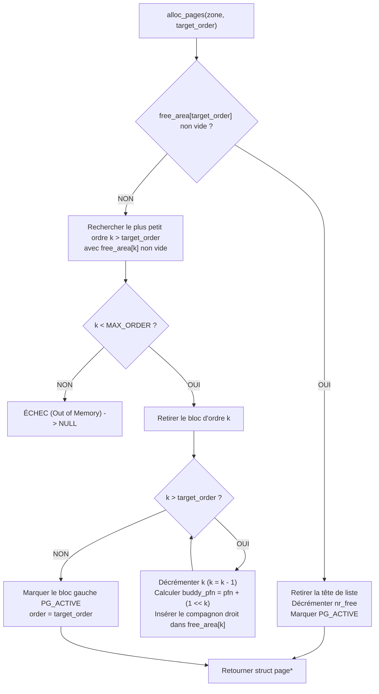
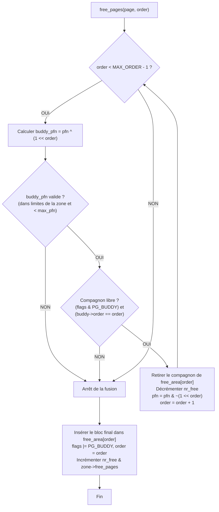

# 🌲 Manuel Architectural : Modèle Mémoire Linux (Buddy Allocator, Zones & Nœuds UMA)

> **Projet :** Kernel From Scratch (KFS) — Architecture x86 (IA-32 / i386)  
> **Composants :** Buddy Allocator, Modélisation `struct page` / PFN, Architecture par Zones (`ZONE_DMA`, `ZONE_NORMAL`, `ZONE_HIGHMEM`), Nœuds Mémoire (`pg_data_t`) & Mapping Virtuel  
> **Conformité de compilation :** `-std=gnu23 -Wall -Wextra -Wpedantic -Wshadow -Werror -ffreestanding`  
> **Statut :** Spécification de Référence et Modèle Algorithmique

---

## Table des Matières
1. [Vue d'Ensemble & Vision Architecturale](#1-vue-densemble--vision-architecturale)
2. [Modélisation des Cadres Physiques (`struct page`) & PFN](#2-modélisation-des-cadres-physiques-struct-page--pfn)
   - [2.1 Le Concept de PFN (Page Frame Number)](#21-le-concept-de-pfn-page-frame-number)
   - [2.2 Structure du Descripteur `struct page`](#22-structure-du-descripteur-struct-page)
   - [2.3 Dimensionnement et Empreinte du Tableau Global `mem_map`](#23-dimensionnement-et-empreinte-du-tableau-global-mem_map)
   - [2.4 Primitives Mathématiques de Conversion](#24-primitives-mathématiques-de-conversion)
3. [Topologie des Nœuds et des Zones Mémoire](#3-topologie-des-nœuds-et-des-zones-mémoire)
   - [3.1 Les Nœuds Mémoire (`pg_data_t` : UMA vs NUMA)](#31-les-nœuds-mémoire-pg_data_t--uma-vs-numa)
   - [3.2 Découpage des Zones sous Architecture x86 IA-32](#32-découpage-des-zones-sous-architecture-x86-ia-32)
   - [3.3 Structure Interne d'une Zone (`struct zone` & `free_area`)](#33-structure-interne-dune-zone-struct-zone--free_area)
4. [Algorithme et Mathématiques du Buddy Allocator](#4-algorithme-et-mathématiques-du-buddy-allocator)
   - [4.1 Ordres et Arbre Binaire des Blocs](#41-ordres-et-arbre-binaire-des-blocs)
   - [4.2 Mathématiques du Compagnon (Propriétés de l'Opérateur XOR)](#42-mathématiques-du-compagnon-propriétés-de-lopérateur-xor)
   - [4.3 Algorithme d'Allocation : Scindage Récursif (*Splitting*)](#43-algorithme-dallocation--scindage-récursif-splitting)
   - [4.4 Algorithme de Libération : Fusion Récursive (*Coalescing*) & Garde-fous](#44-algorithme-de-libération--fusion-récursive-coalescing--garde-fous)
5. [Stratégies de Mapping Virtuel selon les Zones](#5-stratégies-de-mapping-virtuel-selon-les-zones)
   - [5.1 Mapping Direct (Lowmem : `ZONE_DMA` & `ZONE_NORMAL`)](#51-mapping-direct-lowmem--zone_dma--zone_normal)
   - [5.2 Mapping Dynamique Temporaire (`ZONE_HIGHMEM` & `kmap`)](#52-mapping-dynamique-temporaire-zone_highmem--kmap)
6. [Analyse Comparative & Complexité](#6-analyse-comparative--complexité)

---

## 1. Vue d'Ensemble & Vision Architecturale

Dans un système d'exploitation de niveau production tel que Linux, la mémoire physique (RAM) n'est jamais traitée comme un simple tableau plat d'octets. Elle est organisée selon une hiérarchie stricte en 4 niveaux d'abstraction :

```
+-------------------------------------------------------------------------------+
|                       NŒUD MÉMOIRE (pg_data_t / UMA Node)                    |
|       Représente une banque physique de RAM rattachée au bus mémoire          |
+-------------------------------------------------------------------------------+
           │
           ├─── ZONE_DMA      (0 Mo à 16 Mo)      -> Périphériques hérités ISA 24 bits
           │      └── Buddy Allocator (free_area[0 .. MAX_ORDER - 1])
           │
           ├─── ZONE_NORMAL   (16 Mo à 896 Mo)    -> Mappée 1:1 en espace virtuel noyau
           │      └── Buddy Allocator (free_area[0 .. MAX_ORDER - 1])
           │
           └─── ZONE_HIGHMEM  (896 Mo à Fin RAM)  -> Mappings temporaires dynamiques (kmap)
                  └── Buddy Allocator (free_area[0 .. MAX_ORDER - 1])
                           │
                           ▼
                 [ free_area[order] ]
                 Listes circulaires doublement chaînées de `struct page`
```

### Pourquoi cette architecture pour KFS ?
1. **Éradication de la fragmentation externe :** En regroupant les pages physiques en blocs de tailles puissances de deux ($2^{\text{ordre}}$), le Buddy Allocator permet d'allouer et de libérer jusqu'à 1024 pages contiguës (4 Mo) en temps constant $\mathcal{O}(1)$.
2. **Isolation matérielle stricte :** La zone basse (`ZONE_DMA`, $< 16\text{ Mo}$) est préservée pour le matériel requérant un adressage sur 24 bits (ex. contrôleur disquette, Sound Blaster, DMA ISA), empêchant le code applicatif ou le noyau de la saturer.
3. **Abstraction Orientée Objet (`struct page`) :** Le noyau manipule des descripteurs riches contenant le compteur de références, l'ordre et l'état de chaque cadre, plutôt que de simples adresses scalaires brutes.

---

## 2. Modélisation des Cadres Physiques (`struct page`) & PFN

### 2.1 Le Concept de PFN (Page Frame Number)

L'architecture x86 découpe la mémoire physique en trames (*frames*) de 4096 octets ($2^{12}$).  
Le **PFN** est l'index séquentiel absolu du cadre physique en RAM :

$$\text{PFN} = \frac{\text{Adresse Physique}}{4096} = \text{Adresse Physique} \gg 12$$

$$\text{Adresse Physique} = \text{PFN} \times 4096 = \text{PFN} \ll 12$$

| Adresse Physique | PFN (décimal) | PFN (hexadécimal) | Rôle dans le système |
|---|---|---|---|
| `0x00000000` | 0 | `0x00000` | Premier cadre (IVT, BDA BIOS) |
| `0x000A0000` | 160 | `0x000A0` | Mémoire vidéo VGA |
| `0x00100000` | 256 | `0x00100` | Début de la mémoire haute (1 Mo) |
| `0x00200000` | 512 | `0x00200` | Point de chargement binaire du noyau KFS (2 Mo) |
| `0x01000000` | 4 096 | `0x01000` | Frontière de `ZONE_DMA` (16 Mo) |
| `0x38000000` | 229 376 | `0x38000` | Frontière `ZONE_NORMAL` / `HIGHMEM` (896 Mo) |

---

### 2.2 Structure du Descripteur `struct page`

Chaque trame physique de 4 Ko présente dans la machine est représentée par une instance unique de `struct page`.

```c
#include <stdint.h>
#include <stdbool.h>
#include "klibc/utility/list.h"

// Masques de bits d'état (champ flags)
#define PG_RESERVED   (1U << 0)  // Page réservée : non allouable (BIOS, code noyau, matériel)
#define PG_BUDDY      (1U << 1)  // Page libre appartenant au Buddy Allocator
#define PG_ACTIVE     (1U << 2)  // Page allouée et en cours d'utilisation
#define PG_DIRTY      (1U << 3)  // Données modifiées en mémoire
#define PG_SLAB       (1U << 4)  // Page assignée à un cache d'objets (Slab/Kmalloc)

struct page {
    uint32_t         flags;     // Masque d'état (PG_BUDDY, PG_RESERVED, etc.)
    uint32_t         _count;    // Compteur de références actives (0 = page libre)
    uint8_t          order;     // Ordre actuel du bloc dans le Buddy (0..10)
    uint8_t          zone_id;   // Identifiant de la zone (ZONE_DMA, ZONE_NORMAL, ZONE_HIGHMEM)
    struct list_head lru;       // Chaînage intrusif dans la free_list du Buddy Allocator
};
```

> [!NOTE]
> La taille de `struct page` est de **24 octets** sur x86 32 bits (4 B `flags` + 4 B `_count` + 1 B `order` + 1 B `zone_id` + 2 B padding + 8 B `struct list_head`).  
> Elle est conçue pour être compacte tout en permettant une indexation en temps constant.

---

### 2.3 Dimensionnement et Empreinte du Tableau Global `mem_map`

Au démarrage du noyau, un tableau plat `mem_map` est alloué pour couvrir l'intégralité de l'espace physique adressable :

$$\text{Taille de } mem\_map = \text{Nombre total de PFNs} \times \text{sizeof(struct page)}$$

Pour différentes tailles de RAM physique :
* **32 Mo de RAM :** $8\,192\text{ pages} \times 24\text{ B} \approx 192\text{ Ko}$
* **128 Mo de RAM :** $32\,768\text{ pages} \times 24\text{ B} \approx 768\text{ Ko}$
* **512 Mo de RAM :** $131\,072\text{ pages} \times 24\text{ B} \approx 3{,}0\text{ Mo}$
* **1 Go de RAM :** $262\,144\text{ pages} \times 24\text{ B} \approx 6{,}0\text{ Mo}$

L'empreinte mémoire de `mem_map` représente seulement **~0,58 %** de la mémoire physique totale, un coût négligeable en regard des gains de performance et de sécurité.

---

### 2.4 Primitives Mathématiques de Conversion

Ces macros constituent le pivot du sous-système mémoire. Elles convertissent sans branchement conditionnel entre descripteur `struct page`, index PFN et adresse physique :

```c
extern struct page *mem_map;

// Conversion PFN <-> struct page
#define pfn_to_page(pfn)        (&mem_map[(pfn)])
#define page_to_pfn(page)       ((size_t)((page) - mem_map))

// Conversion PFN <-> Adresse Physique (phys_addr_t = uint64_t)
#define pfn_to_phys(pfn)        ((uint64_t)(pfn) << 12)
#define phys_to_pfn(phys)       ((size_t)((phys) >> 12))

// Conversion struct page <-> Adresse Physique
#define page_to_phys(page)      pfn_to_phys(page_to_pfn(page))
#define phys_to_page(phys)      pfn_to_page(phys_to_pfn(phys))
```

---

## 3. Topologie des Nœuds et des Zones Mémoire

### 3.1 Les Nœuds Mémoire (`pg_data_t` : UMA vs NUMA)

- **Architecture NUMA (*Non-Uniform Memory Access*) :** Utilisée sur les serveurs multi-sockets où chaque CPU dispose de canaux de bus mémoire dédiés. Chaque banque est modélisée par un nœud indépendant.
- **Architecture UMA (*Uniform Memory Access*) :** Sur notre cible PC x86 32 bits classique, tous les accès à la RAM transitent par un contrôleur unique avec des temps de latence identiques. Il n'existe donc qu'un **unique nœud global** : `g_contig_node` (équivalent de `contig_page_data` sous Linux).

```c
typedef struct pglist_data {
    size_t           node_start_pfn;       // Premier PFN géré par ce nœud (généralement 0)
    size_t           node_present_pages;   // Nombre total de cadres physiques réels
    size_t           node_spanned_pages;   // Étendue totale (fin - début)
    struct zone      node_zones[ZONE_MAX]; // Les 3 zones physiques (DMA, NORMAL, HIGHMEM)
    struct page     *node_mem_map;         // Pointeur vers le tableau mem_map
} pg_data_t;
```

---

### 3.2 Découpage des Zones sous Architecture x86 IA-32

L'espace physique x86 est découpé en trois zones étanches :

```
0 Mo              16 Mo                            896 Mo                  Max RAM (ex: 4 Go)
+-------------------+--------------------------------+--------------------------------+
|     ZONE_DMA      |          ZONE_NORMAL           |          ZONE_HIGHMEM          |
+-------------------+--------------------------------+--------------------------------+
  ISA 24 bits (4 Ko)   Noyau direct-mappé (Higher-Half)   Espace non permanent (kmap/Ring3)
  PFN: 0 -> 4 096      PFN: 4 096 -> 229 376             PFN: 229 376 -> Fin RAM
```

#### Définition de l'énumération :
```c
enum zone_type {
    ZONE_DMA = 0,     // 0 à 16 Mo : Matériel ISA et buffers DMA basse mémoire
    ZONE_NORMAL,      // 16 Mo à 896 Mo : Code noyau, structures, piles, tables de pages
    ZONE_HIGHMEM,     // > 896 Mo : Utilisable par l'espace utilisateur ou fenêtrage kmap
    ZONE_MAX
};
```

---

### 3.3 Structure Interne d'une Zone (`struct zone` & `free_area`)

Chaque zone contient sa propre instance de Buddy Allocator composée d'un tableau de listes de blocs libres :

```c
#define MAX_ORDER 11 // Ordres 0 à 10 inclus (1 page à 1024 pages = 4 Mo)

struct free_area {
    struct list_head free_list; // Tête de liste circulaire des blocs libres
    size_t           nr_free;   // Nombre de blocs disponibles à cet ordre précis
};

struct zone {
    const char       *name;                 // "DMA", "Normal", "HighMem"
    size_t            zone_start_pfn;       // Premier PFN de la zone
    size_t            spanned_pages;        // Nombre total de pages englobées
    size_t            present_pages;        // Nombre de pages physiques réelles
    size_t            free_pages;           // Total des pages libres utilisables
    struct free_area  free_area[MAX_ORDER]; // Listes de blocs par puissance de 2
};
```

---

## 4. Algorithme et Mathématiques du Buddy Allocator

### 4.1 Ordres et Arbre Binaire des Blocs

Le Buddy Allocator partitionne la mémoire exclusivement en blocs de tailles puissances de deux :

$$\text{Taille du bloc (octets)} = 2^{\text{ordre}} \times 4096$$

| Ordre | Nombre de pages (4 Ko) | Taille cumulée | Cas d'usage type dans KFS |
|---|---|---|---|
| **0** | 1 | **4 Ko** | Table de pages, page de code utilisateur, petit buffer |
| **1** | 2 | **8 Ko** | Pile d'exécution d'un thread ou processus noyau |
| **2** | 4 | **16 Ko** | Structure de table de descripteurs étendue |
| **3** | 8 | **32 Ko** | Tampon réseau ou disque |
| ... | ... | ... | ... |
| **9** | 512 | **2 Mo** | Grande page matérielle sous PAE (*Large Page*) |
| **10** | 1024 | **4 Mo** | Grande page standard PSE ou allocation volumineuse DMA |

---

### 4.2 Mathématiques du Compagnon (Propriétés de l'Opérateur XOR)

Deux blocs de même ordre $k$ adjacents en mémoire forment une paire de compagnons (*buddies*) si et seulement si ils proviennent de la scission d'un bloc parent d'ordre $k+1$.

#### Formule mathématique du compagnon :
Pour un bloc situé au PFN $P$ à l'ordre $k$ :

$$\text{Buddy\_PFN}(P, k) = P \oplus (1 \ll k)$$

```
Exemple : Bloc d'ordre 1 (2 pages) situé au PFN 4 (binaire 0000 0100)
Ordre k = 1 => Masque (1 << 1) = 2 (binaire 0000 0010)
Buddy_PFN = 4 XOR 2 = 6 (binaire 0000 0110)

Les deux blocs compagnons sont :
- Bloc A : [PFN 4, PFN 5]
- Bloc B : [PFN 6, PFN 7]
```

#### Propriétés fondamentales :
1. **Involutivité :** $\text{Buddy\_PFN}(\text{Buddy\_PFN}(P, k), k) = P$.
2. **Alignement du bloc parent fusionné :**  
   Le bloc unifié d'ordre $k+1$ commence obligatoirement à l'adresse du bloc inférieur :
   $$\text{Parent\_PFN} = P \ \& \ \sim(1 \ll k) = \min(P, \text{Buddy\_PFN}(P, k))$$
3. **Indépendance des zones :** Deux blocs situés dans deux zones différentes (ex. PFN 4095 dans `ZONE_DMA` et PFN 4096 dans `ZONE_NORMAL`) ne doivent **jamais** fusionner.

---

### 4.3 Algorithme d'Allocation : Scindage Récursif (*Splitting*)

Lors d'un appel à `alloc_pages(zone, target_order)` :



---

### 4.4 Algorithme de Libération : Fusion Récursive (*Coalescing*) & Garde-fous

Lors d'un appel à `free_pages(page, order)` :



> [!CAUTION]
> **Garde-fou critique (Out-of-Bounds PFN) :**  
> Ne jamais déréférencer `pfn_to_page(buddy_pfn)` sans avoir vérifié au préalable que `buddy_pfn` est strictement inférieur à `node_present_pages` et contenu dans les bornes `[zone_start_pfn, zone_start_pfn + spanned_pages)`. Faute de quoi, un accès hors limites sur le tableau `mem_map` provoque un crash fatal.

---

## 5. Stratégies de Mapping Virtuel selon les Zones

### 5.1 Mapping Direct (Lowmem : `ZONE_DMA` & `ZONE_NORMAL`)

Puisque les zones `ZONE_DMA` et `ZONE_NORMAL` couvrent au maximum 896 Mo, elles sont mappées en totalité de façon linéaire avec le décalage higher-half `0xC0000000` (`PAGE_OFFSET`) dans les tables de pages du noyau :

```
Adresse Physique :  0x00000000 ────────────> 0x38000000 (896 Mo)
                         │                         │
                   + PAGE_OFFSET             + PAGE_OFFSET
                         │                         │
                         ▼                         ▼
Adresse Virtuelle : 0xC0000000 ────────────> 0xF8000000
```

#### Primitives en temps constant $\mathcal{O}(1)$ :
```c
#define PAGE_OFFSET 0xC0000000UL

static inline void *page_to_virt(const struct page *page) {
    uint64_t phys = page_to_phys(page);
    return (void *)(uintptr_t)(phys + PAGE_OFFSET);
}

static inline struct page *virt_to_page(const void *kaddr) {
    uintptr_t phys = (uintptr_t)kaddr - PAGE_OFFSET;
    return phys_to_page(phys);
}
```

---

### 5.2 Mapping Dynamique Temporaire (`ZONE_HIGHMEM` & `kmap`)

Au-delà de 896 Mo physiques, la mémoire ne peut pas être mappée en continu car l'espace d'adressage virtuel 32 bits du noyau est limité à 1 Go (`0xC0000000` à `0xFFFFFFFF`).  
Pour accéder au contenu d'une page physique de `ZONE_HIGHMEM`, le noyau utilise une fenêtre de mapping dynamique :

1. **`kmap(struct page *page)` :**
   - Si la page appartient à `ZONE_DMA` ou `ZONE_NORMAL`, renvoie directement `page_to_virt(page)`.
   - Si la page appartient à `ZONE_HIGHMEM`, sélectionne une entrée libre dans la table de pages de la zone de fenêtrage (ex. `0xFE000000`), inscrit l'adresse physique avec les droits de lecture/écriture, invalide le TLB via `invlpg`, et renvoie l'adresse virtuelle correspondante.
2. **`kunmap(struct page *page)` :**
   - Libère l'entrée dans la fenêtre de mapping et invalide à nouveau l'entrée TLB.

---

## 6. Analyse Comparative & Complexité

| Métrique | Allocateur Bitmap | Liste Chaînée Libre | Buddy Allocator (KFS) |
|---|---|---|---|
| **Complexité d'allocation** | $\mathcal{O}(N)$ (recherche séquentielle de bits) | $\mathcal{O}(1)$ (pop en tête de liste) | $\mathcal{O}(\text{MAX\_ORDER}) = \mathcal{O}(1)$ |
| **Complexité de libération** | $\mathcal{O}(1)$ (clear bit) | $\mathcal{O}(1)$ (push en tête) | $\mathcal{O}(\text{MAX\_ORDER}) = \mathcal{O}(1)$ (coalescing) |
| **Allocations contiguës** | Lente (recherche de séquence de bits consécutifs) | ❌ Impossible sans réorganisation |  **Natif** (blocs de 1 à 1024 pages contiguës) |
| **Fragmentation externe** | Modérée à forte | Très élevée | **Nulle** au niveau des puissances de 2 |
| **Empreinte des métadonnées** | 1 bit / 4 Ko (~0,003 %) | 1 pointeur / bloc libre | 24 octets / 4 Ko (~0,58 %) |
| **Conformité modèle Linux** | Non conforme (utilisé pour boot) | Non conforme |  **Conforme à l'architecture officielle** |
