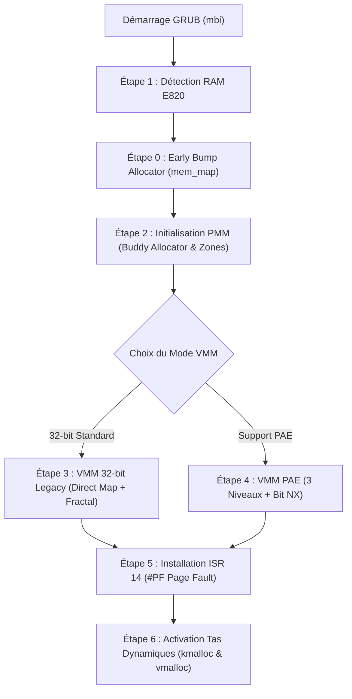

# 🛠️ Manuel d'Architecture & d'Intégration Globale : PMM Buddy/Zones, VMM Legacy & PAE, et Gestionnaire #PF

> **Projet :** Kernel From Scratch (KFS) — Architecture x86 (IA-32 / i386)  
> **Composants :** Détection Multiboot E820, PMM Buddy Allocator & Zones UMA, Pagination 32-bit Legacy, Pagination PAE 3 Niveaux & Bit NX, Exception Page Fault (ISR 14 `#PF`)  
> **Conformité stricte :** `-std=gnu23 -Wall -Wextra -Wpedantic -Wshadow -Werror -ffreestanding`  
> **Alignement architectural :** Parfaitement harmonisé avec [guide_buddy_zones_nodes_memoire.md](file:///home/gcaptari/Documents/Kernel-From-Scratch/doc/guide_buddy_zones_nodes_memoire.md), [guide_implementation_kfs_buddy_zones.md](file:///home/gcaptari/Documents/Kernel-From-Scratch/doc/guide_implementation_kfs_buddy_zones.md) et [guide_kmalloc_vmalloc_kbrk_vbrk.md](file:///home/gcaptari/Documents/Kernel-From-Scratch/doc/guide_kmalloc_vmalloc_kbrk_vbrk.md)  
> **Auteur :** Antigravity AI Assistant

---

## Table des Matières
1. [Vue d'Ensemble & Synergie des Guides Mémoire](#1-vue-densemble--synergie-des-guides-mémoire)
2. [Étape 0 : Frontières du Linker Script & Bump Allocator Précoce](#étape-0--frontières-du-linker-script--bump-allocator-précoce)
3. [Étape 1 : Détection de la RAM via Multiboot (E820)](#étape-1--détection-de-la-ram-via-multiboot-e820)
4. [Étape 2 : Le PMM de Référence KFS : Buddy Allocator & Architecture par Zones](#étape-2--le-pmm-de-référence-kfs--buddy-allocator--architecture-par-zones)
   - [2.1 Pourquoi le Buddy plutôt qu'un Bitmap ?](#21-pourquoi-le-buddy-plutôt-quun-bitmap-)
   - [2.2 L'Interface Physique standard consommée par le VMM](#22-linterface-physique-standard-consommée-par-le-vmm)
   - [2.3 Rôle comparatif du Bitmap Allocator](#23-rôle-comparatif-du-bitmap-allocator)
5. [Étape 3 : Pagination Matérielle 32-bit Legacy & Allocation Dynamique de Tables](#étape-3--pagination-matérielle-32-bit-legacy--allocation-dynamique-de-tables)
   - [3.1 Format Matériel des Entrées PDE & PTE](#31-format-matériel-des-entrées-pde--pte)
   - [3.2 Mécanique du Paging Récursif (Fractal Mapping sur l'entrée 1023)](#32-mécanique-du-paging-récursif-fractal-mapping-sur-lentrée-1023)
   - [3.3 Implémentation du VMM avec Allocation via le Buddy Allocator](#33-implémentation-du-vmm-avec-allocation-via-le-buddy-allocator)
6. [Étape 4 : Évolution vers le Mode PAE (Physical Address Extension) & Bit NX](#étape-4--évolution-vers-le-mode-pae-physical-address-extension--bit-nx)
   - [4.1 Synergie PAE & Buddy Allocator : Adressage 64-bit et Grandes Pages 2 Mo](#41-synergie-pae--buddy-allocator--adressage-64-bit-et-grandes-pages-2-mo)
   - [4.2 Architecture à 3 Niveaux (PDPT -> PD -> PT)](#42-architecture-à-3-niveaux-pdpt---pd---pt)
   - [4.3 Détection CPUID et Activation du Bit NX/XD](#43-détection-cpuid-et-activation-du-bit-nxxd)
   - [4.4 Implémentation du VMM PAE](#44-implémentation-du-vmm-pae)
7. [Étape 5 : Gestionnaire d'Exception Page Fault (ISR 14 `#PF`)](#étape-5--gestionnaire-dexception-page-fault-isr-14-pf)
   - [5.1 Stub d'Interruption en Assembleur (`boot/interrupts.s`)](#51-stub-dinterruption-en-assembleur-bootinterruptss)
   - [5.2 Décodage du Code d'Erreur & Registre CR2 en C](#52-décodage-du-code-derreur--registre-cr2-en-c)
8. [Étape 6 : Séquence d'Amorçage Globale & Intégration dans `kmain.c`](#étape-6--séquence-damorçage-globale--intégration-dans-kmainc)
9. [Étape 7 : Validation sous QEMU & Diagnostic Matériel](#étape-7--validation-sous-qemu--diagnostic-matériel)

---

## 1. Vue d'Ensemble & Synergie des Guides Mémoire

La documentation mémoire de KFS est organisée selon 4 piliers complémentaires et strictement alignés :

```
+---------------------------------------------------------------------------------------------------+
| 1. Spécification Théorique : doc/guide_buddy_zones_nodes_memoire.md                                |
|    -> Modèle Linux (pg_data_t, struct page, PFN, mathématiques XOR, algorithmes splitting/coalesce) |
+---------------------------------------------------------------------------------------------------+
                                                  │
                                                  ▼
+---------------------------------------------------------------------------------------------------+
| 2. Implémentation Modulaire PMM : doc/guide_implementation_kfs_buddy_zones.md                     |
|    -> Code prêt à compiler (-std=gnu23) : list.h, mmzone.h, page.h, buddy.c, pmm.c, vmm.c        |
+---------------------------------------------------------------------------------------------------+
                                                  │
                                                  ▼
+---------------------------------------------------------------------------------------------------+
| 3. Architecture Globale & VMM : doc/guide_implementation_memoire_kfs.md [CE GUIDE]                |
|    -> Intégration PMM Buddy + VMM (32-bit Legacy & PAE), allocation de tables, ISR 14 #PF & Boot  |
+---------------------------------------------------------------------------------------------------+
                                                  │
                                                  ▼
+---------------------------------------------------------------------------------------------------+
| 4. Tas Dynamiques Haut Niveau : doc/guide_kmalloc_vmalloc_kbrk_vbrk.md                            |
|    -> Tas physique continu (kmalloc/kbrk) & Tas virtuel discontinu avec Guard Pages (vmalloc/vbrk)|
+---------------------------------------------------------------------------------------------------+
```

### Chaîne de dépendance à l'exécution :


---

## Étape 0 : Frontières du Linker Script & Bump Allocator Précoce

### 1. Frontières du Linker Script
Pour sanctuariser le noyau en RAM, nous exportons les symboles de début et de fin depuis [`boot/linker.ld`](file:///home/gcaptari/Documents/Kernel-From-Scratch/boot/linker.ld) :

```ld
ENTRY(_start)

SECTIONS
{
	. = 2M;
	_kernel_start = .;

	.text BLOCK(4K) : ALIGN(4K)   { *(.multiboot) *(.text) }
	.rodata BLOCK(4K) : ALIGN(4K) { *(.rodata) }
	.data BLOCK(4K) : ALIGN(4K)   { *(.data) }
	.bss BLOCK(4K) : ALIGN(4K)    { *(COMMON) *(.bss) }

	. = ALIGN(4K);
	_kernel_end = .;
}
```

### 2. Le Bump Allocator Précoce (Bootstrap)
Durant les premières microsecondes du noyau, le Buddy Allocator n'est pas encore initialisé car il requiert lui-même l'allocation préalable du tableau [`mem_map`](file:///home/gcaptari/Documents/Kernel-From-Scratch/arch/i386/mm/page.h).  
Un **Bump Allocator** primitif alloue cette structure séquentiellement directement après `_kernel_end` :

```c
#include <stdint.h>
#include <stddef.h>

extern uint8_t _kernel_end[];
static uintptr_t s_early_alloc_ptr = 0;

void early_alloc_init(void) {
    s_early_alloc_ptr = ((uintptr_t)_kernel_end + 4095UL) & ~4095UL;
}

void *early_alloc_aligned(size_t size, size_t align) {
    s_early_alloc_ptr = (s_early_alloc_ptr + (align - 1)) & ~(align - 1);
    void *ptr = (void *)s_early_alloc_ptr;
    s_early_alloc_ptr += size;
    return ptr;
}

uintptr_t early_alloc_get_end(void) {
    return s_early_alloc_ptr;
}
```

---

## Étape 1 : Détection de la RAM via Multiboot (E820)

GRUB fournit la structure [`multiboot_info_t`](file:///home/gcaptari/Documents/Kernel-From-Scratch/boot/multiboot.h) dont le drapeau `MULTIBOOT_INFO_MMAP` (bit 6) donne accès aux plages détectées par le BIOS :

```c
#include "multiboot.h"
#include <stdint.h>
#include <stddef.h>

#ifndef MULTIBOOT_MEMORY_AVAILABLE
#define MULTIBOOT_MEMORY_AVAILABLE 1
#endif

typedef struct memory_detection_info {
    uint64_t total_usable_ram;
    uint64_t max_physical_addr;
} memory_detection_info_t;

memory_detection_info_t detect_memory(multiboot_info_t *mbi) {
    memory_detection_info_t info = {0, 0};

    if (!(mbi->flags & MULTIBOOT_INFO_MMAP)) {
        return info; // Panic : Carte mémoire absente
    }

    multiboot_mmap_entry_t *mmap = (multiboot_mmap_entry_t *)(uintptr_t)mbi->mmap_addr;
    uintptr_t mmap_end = mbi->mmap_addr + mbi->mmap_length;

    while ((uintptr_t)mmap < mmap_end) {
        if (mmap->type == MULTIBOOT_MEMORY_AVAILABLE) {
            info.total_usable_ram += mmap->len;
            if (mmap->addr + mmap->len > info.max_physical_addr) {
                info.max_physical_addr = mmap->addr + mmap->len;
            }
        }
        mmap = (multiboot_mmap_entry_t *)((uintptr_t)mmap + mmap->size + sizeof(mmap->size));
    }

    return info;
}
```

---

## Étape 2 : Le PMM de Référence KFS : Buddy Allocator & Architecture par Zones

### 2.1 Pourquoi le Buddy plutôt qu'un Bitmap ?

Bien qu'un allocateur Bitmap soit conceptuellement simple, il présente deux faiblesses majeures incompatibles avec un système d'exploitation moderne :
1. **Fragmentation externe critique :** Trouver $N$ pages contiguës dans un Bitmap requiert un parcours linéaire en $\mathcal{O}(M)$ qui échoue dès que la mémoire est fragmentée.
2. **Inadéquation avec le matériel x86 :** Le matériel requiert des alignements stricts (tables de pages alignées sur 4 Ko, répertoires PDPT alignés sur 32 octets, Large Pages alignées sur 2 Mo ou 4 Mo).

Le **Buddy Allocator** (détaillé dans [guide_buddy_zones_nodes_memoire.md](file:///home/gcaptari/Documents/Kernel-From-Scratch/doc/guide_buddy_zones_nodes_memoire.md) et implémenté dans [guide_implementation_kfs_buddy_zones.md](file:///home/gcaptari/Documents/Kernel-From-Scratch/doc/guide_implementation_kfs_buddy_zones.md)) garantit :
* Une complexité d'allocation et de libération en **$\mathcal{O}(1)$**.
* Une allocation contiguë native de $1$ à $1024$ pages ($2^{\text{ordre}}$).
* Un alignement naturel de chaque bloc sur sa propre taille ($2^{\text{ordre}} \times 4096$).

```
Banques de mémoire gérées par le PMM :
├── ZONE_DMA      (0 à 16 Mo)      -> Réservée au matériel hérité ISA 24 bits
├── ZONE_NORMAL   (16 à 896 Mo)    -> Mappée 1:1 en noyau (Higher-Half)
└── ZONE_HIGHMEM  (896 Mo à Max)   -> Mappings dynamiques (kmap) ou pages Ring 3
```

---

### 2.2 L'Interface Physique standard consommée par le VMM

Le gestionnaire de mémoire virtuelle (VMM) et les allocateurs de tas consomment l'API physique du Buddy Allocator via ces primitives unifiées :

```c
#include "arch/i386/mm/page.h"
#include "arch/i386/mm/buddy.h"

// 1. Allouer 1 cadre physique (Ordre 0 = 4 Ko) pour une Page Table
struct page *pt_frame = alloc_pages(ZONE_NORMAL, 0);
phys_addr_t  pt_phys  = page_to_phys(pt_frame);

// 2. Allouer un bloc contigu de 8 pages (Ordre 3 = 32 Ko) pour une pile
struct page *stack_frames = alloc_pages(ZONE_NORMAL, 3);
void        *stack_ptr    = page_to_virt(stack_frames);

// 3. Libérer les pages physiques après usage
free_pages(pt_frame, 0);
free_pages(stack_frames, 3);
```

---

### 2.3 Rôle comparatif du Bitmap Allocator

> [!NOTE]
> Un allocateur Bitmap pur (1 bit par page) peut être utilisé comme solution d'exercice préliminaire ou comme mécanisme de secours ultra-léger dans des environnements très contraints en RAM ($< 8\text{ Mo}$).  
> Dans KFS, l'architecture officielle retenue est le modèle Linux basé sur `struct page` et le **Buddy Allocator**.

---

## Étape 3 : Pagination Matérielle 32-bit Legacy & Allocation Dynamique de Tables

### 3.1 Format Matériel des Entrées PDE & PTE

En mode IA-32 standard (32 bits, 2 niveaux) :

```
31            22 21            12 11                        0
+---------------+---------------+---------------------------+
| Directory Idx |  Table Index  |    Décalage dans la page  |
|    10 bits    |    10 bits    |           12 bits         |
+---------------+---------------+---------------------------+
```

```
31                                     12 11  9 8 7 6 5 4 3 2 1 0
+----------------------------------------+-----+-+-+-+-+-+-+-+-+-+
|   Adresse Physique de Base (4 Ko)      | AVL |G|S|D|A|C|W|U|R|P|
+----------------------------------------+-----+-+-+-+-+-+-+-+-+-+
```

* **Bit 0 (`P`) :** Présent (1 = valide, 0 = faute `#PF`).
* **Bit 1 (`R/W`) :** Écriture autorisée (1 = R/W, 0 = Read-Only).
* **Bit 2 (`U/S`) :** Privilège (1 = User Ring 3, 0 = Supervisor Ring 0).
* **Bit 7 (`PS`) :** Page Size sur PDE (1 = grande page de 4 Mo PSE, 0 = table de 4 Ko).

---

### 3.2 Mécanique du Paging Récursif (Fractal Mapping sur l'entrée 1023)

En configurant l'entrée `1023` du Page Directory pour pointer vers l'adresse physique du Page Directory lui-même, toute la hiérarchie de pagination devient modifiable en mémoire virtuelle sans mapping intermédiaire :

$$\text{Adresse virtuelle de la Page Table } i = \text{0xFFC00000} + (i \times \text{0x1000})$$
$$\text{Adresse virtuelle du Page Directory} = \text{0xFFFFF000}$$

---

### 3.3 Implémentation du VMM avec Allocation via le Buddy Allocator

Dans une pagination dynamique, si une Page Table n'existe pas encore pour une adresse virtuelle demandée, elle est allouée dynamiquement via `alloc_pages(ZONE_NORMAL, 0)` :

```c
#include "arch/i386/mm/page.h"
#include "arch/i386/mm/buddy.h"
#include "arch/i386/mm/vmm.h"
#include "klibc/memory/mem.h"

#define PAGE_PRESENT  (1U << 0)
#define PAGE_WRITABLE (1U << 1)
#define PAGE_USER     (1U << 2)

// Pointeurs fractals vers les tables
#define RECURSIVE_PD_VIRT  ((uint32_t *)0xFFFFF000UL)
#define RECURSIVE_PT_VIRT(pde) ((uint32_t *)(0xFFC00000UL + ((uint32_t)(pde) * 4096UL)))

void vmm_map_page_dynamic(uintptr_t virt, phys_addr_t phys, uint32_t flags) {
    uint32_t pde_idx = virt >> 22;
    uint32_t pte_idx = (virt >> 12) & 0x3FF;

    uint32_t *pd = RECURSIVE_PD_VIRT;

    // Si la Page Table n'est pas présente, on l'alloue via le Buddy Allocator !
    if (!(pd[pde_idx] & PAGE_PRESENT)) {
        struct page *pt_frame = alloc_pages(ZONE_NORMAL, 0);
        if (!pt_frame) return; // OOM

        phys_addr_t pt_phys = page_to_phys(pt_frame);
        pd[pde_idx] = (uint32_t)pt_phys | PAGE_PRESENT | PAGE_WRITABLE | (flags & PAGE_USER);

        // Invalider le TLB pour la nouvelle table accédée via recursive mapping
        asm volatile ("invlpg (%0)" :: "r"(RECURSIVE_PT_VIRT(pde_idx)) : "memory");

        // Nettoyer la nouvelle table
        kmemset(RECURSIVE_PT_VIRT(pde_idx), 0, 4096);
    }

    uint32_t *pt = RECURSIVE_PT_VIRT(pde_idx);
    pt[pte_idx] = ((uint32_t)phys & ~0xFFF) | (flags & 0xFFF) | PAGE_PRESENT;

    asm volatile ("invlpg (%0)" :: "r"(virt) : "memory");
}
```

---

## Étape 4 : Évolution vers le Mode PAE (Physical Address Extension) & Bit NX

### 4.1 Synergie PAE & Buddy Allocator : Adressage 64-bit et Grandes Pages 2 Mo

Le mode PAE étend le bus d'adresses physiques à **36 bits (64 Go de RAM)** :
1. **PMM 64 bits natif :** Notre descripteur `struct page` et les macros `pfn_to_phys()` retournent un type `uint64_t`. Le Buddy Allocator gère donc directement les cadres physiques au-delà de 4 Go dans `ZONE_HIGHMEM` sans modification algorithmique.
2. **Harmonie des Grandes Pages (Large Pages de 2 Mo) :**  
   Sous PAE, une grande page matérielle fait exactement **2 Mo** (512 entrées de 4 Ko).  
   Dans le Buddy Allocator, un bloc d'**Ordre 9** correspond précisément à :
   $$2^9 \times 4096 = 512 \times 4096 = 2\text{ Mo}$$
   Le noyau peut allouer instantanément une page géante de 2 Mo avec `alloc_pages(zone, 9)` et l'inscrire directement dans un Page Directory PAE avec le bit `PS=1` !

---

### 4.2 Architecture à 3 Niveaux (PDPT -> PD -> PT)

```
31  30 29             21 20             12 11                          0
+-----+-----------------+-----------------+----------------------------+
| PDPT| Page Directory  |   Page Table    |   Décalage dans la page    |
|2 bits|     9 bits      |     9 bits      |          12 bits           |
+-----+-----------------+-----------------+----------------------------+
```

---

### 4.3 Détection CPUID et Activation du Bit NX/XD

Le bit **NX (*No-Execute*)** (bit 63) bloque l'exécution de code dans les zones de données ou de pile :

```c
#include <stdint.h>
#include <stdbool.h>

#define PAE_PRESENT   (1ULL << 0)
#define PAE_WRITABLE  (1ULL << 1)
#define PAE_USER      (1ULL << 2)
#define PAE_2MB_PAGE  (1ULL << 7)
#define PAE_NX        (1ULL << 63)

bool check_pae_supported(void) {
    uint32_t edx;
    asm volatile ("cpuid" : "=d"(edx) : "a"(1) : "ebx", "ecx");
    return (edx & (1 << 6)) != 0;
}

bool check_nx_supported(void) {
    uint32_t edx;
    asm volatile ("cpuid" : "=d"(edx) : "a"(0x80000001) : "ebx", "ecx");
    return (edx & (1 << 20)) != 0;
}

void pae_enable_nx(void) {
    if (check_nx_supported()) {
        uint32_t low, high;
        asm volatile ("rdmsr" : "=a"(low), "=d"(high) : "c"(0xC0000080));
        low |= (1 << 11); // Bit NXE
        asm volatile ("wrmsr" :: "a"(low), "d"(high), "c"(0xC0000080));
    }
}
```

---

### 4.4 Implémentation du VMM PAE

```c
#include "klibc/memory/mem.h"

static uint64_t g_pdpt[4] __attribute__((aligned(32)));
static uint64_t g_pae_pd[4][512] __attribute__((aligned(4096)));
static uint64_t g_pae_pt_first[512] __attribute__((aligned(4096)));

void vmm_init_pae(void) {
    if (!check_pae_supported()) return;

    kmemset(g_pdpt, 0, sizeof(g_pdpt));
    kmemset(g_pae_pd, 0, sizeof(g_pae_pd));
    kmemset(g_pae_pt_first, 0, sizeof(g_pae_pt_first));

    // 1. Activer NXE
    pae_enable_nx();

    // 2. Relier PDPT aux 4 Page Directories
    for (int i = 0; i < 4; i++) {
        g_pdpt[i] = ((uint64_t)(uintptr_t)&g_pae_pd[i][0]) | PAE_PRESENT;
    }

    // 3. Relier le premier Page Directory à la Page Table basse
    g_pae_pd[0][0] = ((uint64_t)(uintptr_t)g_pae_pt_first) | PAE_PRESENT | PAE_WRITABLE;

    // 4. Mappage d'identité des 2 premiers Mo (512 entrées de 4 Ko)
    for (uint64_t i = 0; i < 512; i++) {
        g_pae_pt_first[i] = (i * 4096ULL) | PAE_PRESENT | PAE_WRITABLE;
    }

    // 5. Charger CR3 avec l'adresse du PDPT
    asm volatile ("movl %0, %%cr3" :: "r"(g_pdpt));

    // 6. Activer le bit PAE (bit 5) dans CR4
    uint32_t cr4;
    asm volatile ("movl %%cr4, %0" : "=r"(cr4));
    cr4 |= (1 << 5);
    asm volatile ("movl %0, %%cr4" :: "r"(cr4));

    // 7. Activer la pagination (bit 31 PG) dans CR0
    uint32_t cr0;
    asm volatile ("movl %%cr0, %0" : "=r"(cr0));
    cr0 |= 0x80000000U;
    asm volatile ("movl %0, %%cr0" :: "r"(cr0));
}
```

---

## Étape 5 : Gestionnaire d'Exception Page Fault (ISR 14 `#PF`)

L'exception 14 est cruciale car elle permet d'intercepter les accès illégaux, d'implémenter la pagination à la demande (*demand paging*) et de capturer les débordements sur les **Pages de Garde** de `vmalloc`.

### 5.1 Stub d'Interruption en Assembleur (`boot/interrupts.s`)

> [!IMPORTANT]
> Lors d'un `#PF`, le processeur empile un **Code d'Erreur (32 bits)** sur la pile. L'assembleur doit impérativement le dépiler avant d'exécuter `iret`.

```nasm
[BITS 32]
global isr14_stub
extern page_fault_c_handler

isr14_stub:
    ; Pile CPU : [EFLAGS, CS, EIP, ERROR_CODE]
    pusha
    push ds
    push es
    push fs
    push gs

    mov ax, 0x10
    mov ds, ax
    mov es, ax

    push esp                ; Pointeur vers struct registers*
    call page_fault_c_handler
    add esp, 4

    pop gs
    pop fs
    pop es
    pop ds
    popa

    add esp, 4              ; Dépiler l'ERROR_CODE matériel
    iret
```

---

### 5.2 Décodage du Code d'Erreur & Registre CR2 en C

```c
#include <stdint.h>
#include "klibc/utility/printf.h"

struct registers {
    uint32_t gs, fs, es, ds;
    uint32_t edi, esi, ebp, esp, ebx, edx, ecx, eax;
    uint32_t err_code;
    uint32_t eip, cs, eflags;
};

void page_fault_c_handler(struct registers *regs) {
    uint32_t faulting_address;
    asm volatile ("movl %%cr2, %0" : "=r"(faulting_address));

    int present      = (regs->err_code & (1 << 0)); // 0: Non présent (Guard Page ou page non mappée)
    int write        = (regs->err_code & (1 << 1)); // 1: Écriture, 0: Lecture
    int user         = (regs->err_code & (1 << 2)); // 1: User Ring 3, 0: Kernel Ring 0
    int reserved_bit = (regs->err_code & (1 << 3)); // 1: Bit réservé écrasé
    int inst_fetch   = (regs->err_code & (1 << 4)); // 1: Violation bit NX (tentative d'exécution)

    printf("\n=================== KERNEL PANIC : PAGE FAULT (#PF) ===================\n");
    printf("Adresse virtuelle fautive (CR2) : 0x%08x\n", faulting_address);
    printf("Instruction incriminée    (EIP) : 0x%08x\n", regs->eip);
    printf("Code d'erreur matériel          : 0x%08x [ ", regs->err_code);

    if (!present)    printf("NON_PRESENTE ");
    else             printf("VIOLATION_DROITS ");

    if (write)       printf("ECRITURE ");
    else             printf("LECTURE ");

    if (user)        printf("RING3_USER ");
    else             printf("RING0_KERNEL ");

    if (reserved_bit)printf("BIT_RESERVE_ECRASE ");
    if (inst_fetch)  printf("EXECUTION_NX_BLOQUEE ");

    printf("]\n");
    printf("========================================================================\n");

    asm volatile ("cli; hlt");
}
```

---

## Étape 6 : Séquence d'Amorçage Globale & Intégration dans `kmain.c`

Dans [`kernel/kmain.c`](file:///home/gcaptari/Documents/Kernel-From-Scratch/kernel/kmain.c), le sous-système mémoire s'initialise dans un ordre strict :

```c
#include "multiboot.h"
#include "arch/i386/mm/pmm.h"
#include "arch/i386/mm/vmm.h"
#include "arch/i386/mm/buddy.h"
#include "klibc/memory/kheap.h"
#include "klibc/memory/vheap.h"
#include "klibc/utility/printf.h"

void kinit_memory(multiboot_info_t *mbi) {
    printf("[BOOT] 1. Initialisation du PMM (Buddy Allocator & Zones)...\n");
    init_pmm(mbi);

    printf("[BOOT] 2. Initialisation du VMM & Activation de la Pagination...\n");
    init_vmm(); // ou vmm_init_pae() selon le mode choisi

    printf("[BOOT] 3. Validation du Buddy Allocator...\n");
    struct page *test_page = alloc_pages(ZONE_NORMAL, 2); // 4 pages = 16 Ko
    if (test_page) {
        printf("       -> Bloc ordre 2 alloue au PFN %d (Phys: 0x%llx, Virt: 0x%p)\n",
               (int)page_to_pfn(test_page), page_to_phys(test_page), page_to_virt(test_page));
        free_pages(test_page, 2);
    }

    printf("[BOOT] 4. Tas Dynamiques Operationnels (kmalloc & vmalloc disponibles) !\n");
}
```

---

## Étape 7 : Validation sous QEMU & Diagnostic Matériel

Depuis la console de contrôle QEMU (`Ctrl+Alt+2` ou `-monitor stdio`) :

```bash
# 1. Vérifier l'état des registres de pagination
(qemu) info registers
# -> CR0 doit avoir le bit 31 (PG=1)
# -> CR4 doit avoir le bit 5 (PAE=1 si PAE actif)
# -> CR3 doit pointer vers l'adresse physique valide de votre table

# 2. Inspecter les tables de pages physiques et leurs permissions
(qemu) info mem
# Exemple :
# 0000000000000000-0000000000400000 0000000000400000 -rw
# 00000000c0000000-00000000c0400000 0000000000400000 -rw

# 3. Inspecter les traductions en cache TLB
(qemu) info tlb
```
