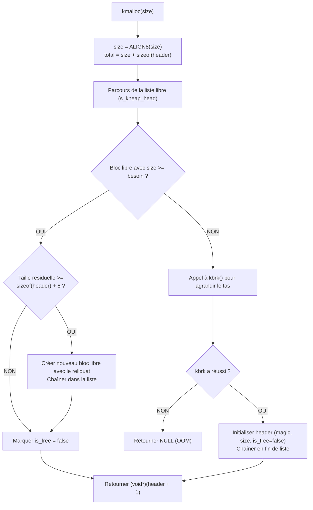

# 🧠 Guide d'Implémentation Complet : Tas Physique (`kmalloc`/`kbrk`) & Tas Virtuel (`vmalloc`/`vbrk`)

> **Projet :** Kernel From Scratch (KFS) — Sous-Système d'Allocation Dynamique  
> **Composants :** Tas Physique (`kmalloc`, `kfree`, `ksize`, `kbrk`) & Tas Virtuel Discontinu (`vmalloc`, `vfree`, `vsize`, `vbrk`)  
> **Conformité stricte :** `-std=gnu23 -Wall -Wextra -Wpedantic -Wshadow -Werror -ffreestanding`  
> **Auteur :** Antigravity AI Assistant

---

## Table des Matières
1. [Dualité Fondamentale : Mémoire Physique vs Mémoire Virtuelle](#1-dualité-fondamentale--mémoire-physique-vs-mémoire-virtuelle)
2. [Cartographie de l'Espace Virtuel Noyau (Higher-Half)](#2-cartographie-de-lespace-virtuel-noyau-higher-half)
3. [Partie 1 : Le Tas Physique Continu (`kmalloc`, `kfree`, `ksize`, `kbrk`)](#partie-1--le-tas-physique-continu-kmalloc-kfree-ksize-kbrk)
   - [3.1 Rôle et Mécanisme de Coupure de `kbrk`](#31-rôle-et-mécanisme-de-coupure-de-kbrk)
   - [3.2 Modélisation des Blocs, Alignement 8 Octets & Nombre Magique](#32-modélisation-des-blocs-alignement-8-octets--nombre-magique)
   - [3.3 Algorithme d'Allocation (First-Fit & Scindage)](#33-algorithme-dallocation-first-fit--scindage)
   - [3.4 Libération & Fusion Bidirectionnelle ($\mathcal{O}(1)$ Coalescing)](#34-libération--fusion-bidirectionnelle-mathcalo1-coalescing)
4. [Partie 2 : Le Tas Virtuel Discontinu (`vmalloc`, `vfree`, `vsize`, `vbrk`)](#partie-2--le-tas-virtuel-discontinu-vmalloc-vfree-vsize-vbrk)
   - [4.1 Pourquoi `vmalloc` ? Résolution de la Fragmentation Externe](#41-pourquoi-vmalloc--résolution-de-la-fragmentation-externe)
   - [4.2 Descripteur `struct vm_struct` & Pages de Garde (*Guard Pages*)](#42-descripteur-struct-vm_struct--pages-de-garde-guard-pages)
   - [4.3 Algorithmes de Réservation, Mapping et Rollback](#43-algorithmes-de-réservation-mapping-et-rollback)
5. [Code Source Complet & Modulaire](#5-code-source-complet--modulaire)
   - [5.1 `klibc/memory/kheap.h` & `kheap.c`](#51-klibcmemorykheaph--kheapc)
   - [5.2 `klibc/memory/vheap.h` & `vheap.c`](#52-klibcmemoryvheaph--vheapc)
   - [5.3 Configuration Makefile (`klibc/memory/module.mk`)](#53-configuration-makefile-klibcmemorymodulemk)
6. [Batterie de Tests de Validation sous `kmain.c`](#6-batterie-de-tests-de-validation-sous-kmainc)

---

## 1. Dualité Fondamentale : Mémoire Physique vs Mémoire Virtuelle

Dans un noyau monolithique (comme Linux ou KFS), il existe deux besoins d'allocation dynamique aux propriétés antagonistes :

| Propriété | Famille Physique (`kmalloc`) | Famille Virtuelle (`vmalloc`) |
|---|---|---|
| **Contiguïté Physique** |  **Impérativement contiguë en RAM** | ❌ **Non contiguë** (pages dispersées en RAM) |
| **Contiguïté Virtuelle**|  Contiguë |  Contiguë |
| **Impact sur les Tables**| **Nul** (plage déjà mappée 1:1) | **Mise à jour des PTEs** et flush TLB (`invlpg`) |
| **Vitesse d'Allocation** | **Ultra-rapide** (quelques cycles) | Plus lente (mise à jour des tables de pages) |
| **Taille Recommandée**   | Petites à moyennes (32 B à 128 Ko) | Grandes allocations (128 Ko à plusieurs Mo) |
| **Cas d'Usage Typiques** | Structures noyau (`task_struct`, buffers DMA) | Modules noyau, gros buffers de fichiers, bitmaps vidéo |

---

## 2. Cartographie de l'Espace Virtuel Noyau (Higher-Half)

Pour éviter toute interférence entre l'espace utilisateur, le noyau, le tas physique et le tas virtuel, l'espace d'adressage virtuel est partitionné :

```
0xFFFFFFFF +---------------------------------------------------------------+
           | Recursive Paging / Fractal Mapping (4 Mo)                     | 0xFFC00000 - 0xFFFFFFFF
0xFF000000 +---------------------------------------------------------------+
           | Fenêtre kmap (Accès dynamique ZONE_HIGHMEM) (4 Mo)            | 0xFE000000 - 0xFE400000
           +---------------------------------------------------------------+
           | VMALLOC AREA (vmalloc / vfree / vbrk) (~736 Mo)               | 0xD0000000 - 0xFDFFFFFF
           | Pages virtuelles contiguës avec Pages de Garde (#PF)          |
0xD0000000 +---------------------------------------------------------------+
           | KERNEL HEAP (kmalloc / kfree / kbrk) (240 Mo)                 | 0xC1000000 - 0xCFFFFFFF
           | Mappé continu / Direct-mapped                                 |
0xC1000000 +---------------------------------------------------------------+
           | CODE NOYAU, DONNÉES, BSS & TABLE MEM_MAP (16 Mo)              | 0xC0000000 - 0xC1000000
0xC0000000 +---------------------------------------------------------------+ <-- KERNEL_BASE_VIRTUAL
           | ESPACE UTILISATEUR (User-space Ring 3) (3 Go)                 | 0x00000000 - 0xBFFFFFFF
0x00000000 +---------------------------------------------------------------+
```

---

## Partie 1 : Le Tas Physique Continu (`kmalloc`, `kfree`, `ksize`, `kbrk`)

### 3.1 Rôle et Mécanisme de Coupure de `kbrk`

Dans les systèmes Unix, la fonction système `brk` contrôle la limite supérieure du segment de données (`break pointer`).  
**`kbrk`** reproduit ce comportement pour le tas physique du noyau :

* **Pointeur courant :** `s_cur_kbrk` (initialisé à `0xC1000000`).
* **Lecture de l'état :** `kbrk(NULL)` renvoie l'adresse virtuelle actuelle de coupure.
* **Croissance du tas (`new_brk > s_cur_kbrk`) :**  
  Le noyau calcule le nombre de nouvelles pages de 4 Ko nécessaires, alloue des cadres physiques auprès du Buddy Allocator (`alloc_pages(ZONE_NORMAL, 0)`), les mappe dans la table de pages via `vmm_map_page()`, et déplace le pointeur.
* **Décroissance du tas (`new_brk < s_cur_kbrk`) :**  
  Les pages superflues sont démappées (`vmm_unmap_page()`) et restituées au Buddy Allocator (`free_pages()`).

---

### 3.2 Modélisation des Blocs, Alignement 8 Octets & Nombre Magique

Chaque bloc de données alloué par `kmalloc` est immédiatement précédé par un en-tête caché (`kmalloc_header_t`) :

```
En-tête de bloc (24 octets)                 Zone de données utile
+------------------------------------------+---------------------------------------+
| magic | size | is_free | next | prev | … | Pointeur retourné par kmalloc() ----> |
+------------------------------------------+---------------------------------------+
```

1. **Nombre Magique (`KMALLOC_MAGIC = 0x4B4D414CU` / "KMAL") :**  
   Permet à `kfree()` et `ksize()` de valider l'intégrité du bloc avant toute manipulation et d'intercepter les doubles libérations (*double-free*) ou pointeurs corrompus.
2. **Alignement 8 octets (`ALIGN8`) :**  
   Garantit que l'adresse transmise à l'utilisateur est divisible par 8, évitant tout défaut d'alignement pour les entiers 64 bits (`uint64_t`) et instructions vectorielles SSE.

---

### 3.3 Algorithme d'Allocation (First-Fit & Scindage)



---

### 3.4 Libération & Fusion Bidirectionnelle ($\mathcal{O}(1)$ Coalescing)

Lors d'un appel à `kfree(ptr)` :
1. Récupération de l'en-tête : `header = ((kmalloc_header_t *)ptr) - 1`.
2. Vérification du nombre magique : `if (header->magic != KMALLOC_MAGIC) panic_or_return()`.
3. Marquage : `header->is_free = true`.
4. **Fusion avec le voisin de droite :** Si `header->next` existe et est libre, absorber sa taille et le retirer de la liste.
5. **Fusion avec le voisin de gauche :** Si `header->prev` existe et est libre, absorber le bloc courant dans `prev`.
6. Si le bloc résultant est situé en queue de tas, possibilité de réduire la frontière avec `kbrk()`.

---

## Partie 2 : Le Tas Virtuel Discontinu (`vmalloc`, `vfree`, `vsize`, `vbrk`)

### 4.1 Pourquoi `vmalloc` ? Résolution de la Fragmentation Externe

Après plusieurs heures de fonctionnement, la RAM physique peut être morcelée : de nombreuses pages individuelles sont libres, mais aucun bloc contigu de 64 Ko ou 1 Mo n'est disponible.
* `kmalloc` échouerait immédiatement faute de pages physiques contiguës.
* `vmalloc` alloue des pages physiques éparpillées en RAM (ordre 0 dans le Buddy) et les mappe côte à côte dans une plage virtuelle continue !

---

### 4.2 Descripteur `struct vm_struct` & Pages de Garde (*Guard Pages*)

Chaque zone allouée par `vmalloc` est décrite par une structure de traçabilité :

```c
struct vm_struct {
    void              *addr;      // Adresse virtuelle de début
    size_t             size;      // Taille demandée en octets
    size_t             nr_pages;  // Nombre de pages physiques réservées
    struct page      **pages;     // Tableau des pointeurs vers les struct page physiques
    struct vm_struct  *next;      // Maillon de chaînage global
};
```

#### Page de Garde (*Guard Page*) :
À la suite immédiate de chaque allocation `vmalloc`, une page virtuelle supplémentaire est laissée **volontairement non mappée (Present = 0)**.  
Si un composant du noyau déborde d'un octet de son tampon, le processeur déclenche instantanément une faute de page (`#PF`), isolant immédiatement le bug avant qu'il ne corrompe une autre zone mémoire !

---

### 4.3 Algorithmes de Réservation, Mapping et Rollback

1. **Alignement :** La taille demandée est arrondie au multiple supérieur de 4096 octets (`nr_pages = size / 4096`).
2. **Réservation de la fenêtre virtuelle :** `vbrk()` réserve `(nr_pages + 1) * 4096` octets (+1 pour la page de garde).
3. **Allocation physique et mapping :**  
   Pour chaque page $i$ de $0$ à $\text{nr\_pages} - 1$ :
   - Appel à `alloc_pages(ZONE_NORMAL, 0)`.
   - Si allocation échouée : **Rollback intégral** (dé-mapper les pages déjà liées, restituer les cadres physiques au Buddy, libérer les descripteurs et restaurer le `vbrk`).
   - Lier l'adresse virtuelle à l'adresse physique dans la table de pages via `vmm_map_page()`.

---

## 5. Code Source Complet & Modulaire

### 5.1 `klibc/memory/kheap.h` & `kheap.c`

#### Fichier d'en-tête : **`klibc/memory/kheap.h`**
```c
#ifndef KFS_KHEAP_H
#define KFS_KHEAP_H

#include <stddef.h>

void *kbrk(void *new_brk);
void *kmalloc(size_t size);
void  kfree(void *ptr);
size_t ksize(const void *ptr);

#endif // KFS_KHEAP_H
```

#### Implémentation : **`klibc/memory/kheap.c`**
```c
#include "kheap.h"
#include "arch/i386/mm/buddy.h"
#include "arch/i386/mm/vmm.h"
#include <stdint.h>
#include <stdbool.h>

#define KMALLOC_MAGIC  0x4B4D414CU // "KMAL"
#define KHEAP_BASE     0xC1000000UL // Base virtuelle du tas physique
#define KHEAP_MAX      0xCFFFFFFFUL // Fin maximale du tas physique (240 Mo)
#define ALIGN8(x)      (((x) + 7UL) & ~7UL)

typedef struct kmalloc_header {
    uint32_t               magic;
    size_t                 size;
    bool                   is_free;
    struct kmalloc_header *next;
    struct kmalloc_header *prev;
} kmalloc_header_t;

static kmalloc_header_t *s_kheap_head = NULL;
static uintptr_t         s_cur_kbrk   = KHEAP_BASE;

void *kbrk(void *new_brk) {
    if (!new_brk) {
        return (void *)s_cur_kbrk;
    }

    uintptr_t target = (uintptr_t)new_brk;
    if (target < KHEAP_BASE || target > KHEAP_MAX) {
        return (void *)-1;
    }

    // Agrandissement du tas : allocation physique et mapping virtuel
    if (target > s_cur_kbrk) {
        size_t old_page = (s_cur_kbrk + 4095UL) / 4096UL;
        size_t new_page = (target + 4095UL) / 4096UL;

        for (size_t p = old_page; p < new_page; p++) {
            struct page *frame = alloc_pages(ZONE_NORMAL, 0);
            if (!frame) return (void *)-1;

            uintptr_t vaddr = p * 4096UL;
            vmm_map_page(vaddr, page_to_phys(frame), 0x03); // Present | R/W
        }
    }
    // Réduction du tas : dé-mapping et restitution des pages au Buddy
    else if (target < s_cur_kbrk) {
        size_t old_page = (s_cur_kbrk + 4095UL) / 4096UL;
        size_t new_page = (target + 4095UL) / 4096UL;

        for (size_t p = new_page; p < old_page; p++) {
            uintptr_t vaddr = p * 4096UL;
            struct page *frame = virt_to_page((void *)vaddr);
            vmm_unmap_page(vaddr);
            if (frame) {
                free_pages(frame, 0);
            }
        }
    }

    void *prev_brk = (void *)s_cur_kbrk;
    s_cur_kbrk = target;
    return prev_brk;
}

void *kmalloc(size_t size) {
    if (size == 0) return NULL;

    size_t aligned_size = ALIGN8(size);
    kmalloc_header_t *curr = s_kheap_head;

    // 1. Recherche d'un bloc libre (First-Fit)
    while (curr) {
        if (curr->is_free && curr->size >= aligned_size) {
            // Scindage si le reliquat est suffisant
            if (curr->size >= aligned_size + sizeof(kmalloc_header_t) + 8) {
                kmalloc_header_t *split = (kmalloc_header_t *)((uint8_t *)(curr + 1) + aligned_size);
                split->magic   = KMALLOC_MAGIC;
                split->size    = curr->size - aligned_size - sizeof(kmalloc_header_t);
                split->is_free = true;
                split->next    = curr->next;
                split->prev    = curr;

                if (curr->next) curr->next->prev = split;
                curr->next = split;
                curr->size = aligned_size;
            }
            curr->is_free = false;
            return (void *)(curr + 1);
        }
        curr = curr->next;
    }

    // 2. Extension du tas via kbrk
    size_t total_needed = sizeof(kmalloc_header_t) + aligned_size;
    void *old_brk = kbrk(NULL);
    void *new_brk = (void *)((uintptr_t)old_brk + total_needed);

    if (kbrk(new_brk) == (void *)-1)
        return NULL;

    kmalloc_header_t *new_block = (kmalloc_header_t *)old_brk;
    new_block->magic   = KMALLOC_MAGIC;
    new_block->size    = aligned_size;
    new_block->is_free = false;
    new_block->next    = NULL;
    new_block->prev    = NULL;

    if (!s_kheap_head) {
        s_kheap_head = new_block;
    } else {
        kmalloc_header_t *tail = s_kheap_head;
        while (tail->next) tail = tail->next;
        tail->next = new_block;
        new_block->prev = tail;
    }

    return (void *)(new_block + 1);
}

void kfree(void *ptr) {
    if (!ptr) return;

    kmalloc_header_t *header = ((kmalloc_header_t *)ptr) - 1;
    if (header->magic != KMALLOC_MAGIC) return; // Protection corruption

    header->is_free = true;

    // Coalescing avec le voisin de droite
    if (header->next && header->next->is_free) {
        header->size += sizeof(kmalloc_header_t) + header->next->size;
        header->next = header->next->next;
        if (header->next) header->next->prev = header;
    }

    // Coalescing avec le voisin de gauche
    if (header->prev && header->prev->is_free) {
        header->prev->size += sizeof(kmalloc_header_t) + header->size;
        header->prev->next = header->next;
        if (header->next) header->next->prev = header->prev;
    }
}

size_t ksize(const void *ptr) {
    if (!ptr) return 0;
    const kmalloc_header_t *header = ((const kmalloc_header_t *)ptr) - 1;
    if (header->magic != KMALLOC_MAGIC) return 0;
    return header->size;
}
```

---

### 5.2 `klibc/memory/vheap.h` & `vheap.c`

#### Fichier d'en-tête : **`klibc/memory/vheap.h`**
```c
#ifndef KFS_VHEAP_H
#define KFS_VHEAP_H

#include <stddef.h>

void *vbrk(void *new_vbrk);
void *vmalloc(size_t size);
void  vfree(void *ptr);
size_t vsize(const void *ptr);

#endif // KFS_VHEAP_H
```

#### Implémentation avec Pages de Garde : **`klibc/memory/vheap.c`**
```c
#include "vheap.h"
#include "kheap.h"
#include "arch/i386/mm/buddy.h"
#include "arch/i386/mm/vmm.h"
#include <stdint.h>

#define VMALLOC_START 0xD0000000UL
#define VMALLOC_END   0xFDFFFFFFUL
#define PAGE_SIZE     4096UL

struct vm_struct {
    void              *addr;
    size_t             size;
    size_t             nr_pages;
    struct page      **pages;
    struct vm_struct  *next;
};

static struct vm_struct *s_vmlist   = NULL;
static uintptr_t         s_cur_vbrk = VMALLOC_START;

void *vbrk(void *new_vbrk) {
    if (!new_vbrk) {
        return (void *)s_cur_vbrk;
    }

    uintptr_t target = (uintptr_t)new_vbrk;
    if (target < VMALLOC_START || target > VMALLOC_END) {
        return (void *)-1;
    }

    void *prev_vbrk = (void *)s_cur_vbrk;
    s_cur_vbrk = target;
    return prev_vbrk;
}

void *vmalloc(size_t size) {
    if (size == 0) return NULL;

    size_t page_aligned_size = (size + PAGE_SIZE - 1) & ~(PAGE_SIZE - 1);
    size_t nr_pages = page_aligned_size / PAGE_SIZE;

    // Inclure 1 page supplémentaire pour la Page de Garde (Guard Page)
    size_t total_virt_size = page_aligned_size + PAGE_SIZE;

    void *virt_start = vbrk(NULL);
    void *virt_end   = (void *)((uintptr_t)virt_start + total_virt_size);

    if (vbrk(virt_end) == (void *)-1)
        return NULL; // Plage virtuelle saturée

    struct vm_struct *area = (struct vm_struct *)kmalloc(sizeof(struct vm_struct));
    if (!area) {
        vbrk(virt_start);
        return NULL;
    }

    area->addr     = virt_start;
    area->size     = size;
    area->nr_pages = nr_pages;
    area->pages    = (struct page **)kmalloc(nr_pages * sizeof(struct page *));
    if (!area->pages) {
        kfree(area);
        vbrk(virt_start);
        return NULL;
    }

    // Allocation et mapping individuel des pages physiques
    for (size_t i = 0; i < nr_pages; i++) {
        struct page *p = alloc_pages(ZONE_NORMAL, 0);
        if (!p) {
            // Rollback en cas d'échec partiel
            for (size_t j = 0; j < i; j++) {
                vmm_unmap_page((uintptr_t)virt_start + (j * PAGE_SIZE));
                free_pages(area->pages[j], 0);
            }
            kfree(area->pages);
            kfree(area);
            vbrk(virt_start);
            return NULL;
        }

        area->pages[i] = p;
        uintptr_t cur_vaddr = (uintptr_t)virt_start + (i * PAGE_SIZE);
        vmm_map_page(cur_vaddr, page_to_phys(p), 0x03); // Present | R/W
    }

    // Note : La dernière page (Guard Page) n'est volontairement PAS mappée (Present = 0)

    area->next = s_vmlist;
    s_vmlist = area;

    return area->addr;
}

void vfree(void *ptr) {
    if (!ptr) return;

    struct vm_struct **prev = &s_vmlist;
    struct vm_struct  *curr = s_vmlist;

    while (curr) {
        if (curr->addr == ptr) {
            *prev = curr->next;
            break;
        }
        prev = &curr->next;
        curr = curr->next;
    }

    if (!curr) return;

    // Dé-mapping et libération physique
    for (size_t i = 0; i < curr->nr_pages; i++) {
        uintptr_t vaddr = (uintptr_t)curr->addr + (i * PAGE_SIZE);
        vmm_unmap_page(vaddr);
        free_pages(curr->pages[i], 0);
    }

    kfree(curr->pages);
    kfree(curr);
}

size_t vsize(const void *ptr) {
    if (!ptr) return 0;
    const struct vm_struct *curr = s_vmlist;
    while (curr) {
        if (curr->addr == ptr) return curr->size;
        curr = curr->next;
    }
    return 0;
}
```

---

### 5.3 Configuration Makefile (`klibc/memory/module.mk`)

Mettez à jour [`klibc/memory/module.mk`](file:///home/gcaptari/Documents/Kernel-From-Scratch/klibc/memory/module.mk) :

```make
INCLUDES += -Iklibc/memory

# --- Sources to be compiled ---
SRCS	+=	klibc/memory/kmemcpy.c	\
			klibc/memory/kmemmove.c	\
			klibc/memory/kmemset.c  \
			klibc/memory/kmemsetw.c	\
			klibc/memory/kmemsetl.c \
			klibc/memory/kheap.c    \
			klibc/memory/vheap.c
```

---

## 6. Batterie de Tests de Validation sous `kmain.c`

Insérez cette suite de tests dans [`kernel/kmain.c`](file:///home/gcaptari/Documents/Kernel-From-Scratch/kernel/kmain.c) :

```c
#include "klibc/memory/kheap.h"
#include "klibc/memory/vheap.h"
#include "klibc/utility/printf.h"

void test_dynamic_memory(void) {
    printf("\n================ [TEST] TAS PHYSIQUE (KMALLOC & KBRK) ================\n");
    printf("[1] kbrk(NULL) initial : 0x%p\n", kbrk(NULL));

    char *b1 = (char *)kmalloc(120);
    printf("[2] kmalloc(120)  -> 0x%p (ksize = %d B)\n", b1, (int)ksize(b1));

    char *b2 = (char *)kmalloc(300);
    printf("[3] kmalloc(300)  -> 0x%p (ksize = %d B)\n", b2, (int)ksize(b2));

    kfree(b1);
    printf("[4] Libération de b1 effectuee avec succes.\n");

    char *b3 = (char *)kmalloc(80);
    printf("[5] kmalloc(80)   -> 0x%p (doit reutiliser l'espace de b1)\n", b3);

    kfree(b2);
    kfree(b3);
    printf("[6] Tout le tas kmalloc a ete libere et fusionne (Coalescing).\n");

    printf("\n================ [TEST] TAS VIRTUEL (VMALLOC & VBRK) ================\n");
    printf("[1] vbrk(NULL) initial : 0x%p\n", vbrk(NULL));

    // Allocation de 64 Ko (16 pages discontinues + 1 page de garde)
    uint32_t *vbuf = (uint32_t *)vmalloc(64 * 1024);
    printf("[2] vmalloc(64 Ko) -> 0x%p (vsize = %d B)\n", vbuf, (int)vsize(vbuf));

    // Test d'écriture et lecture au travers de toutes les pages virtuelles
    for (size_t i = 0; i < (64 * 1024) / sizeof(uint32_t); i++) {
        vbuf[i] = (uint32_t)(i * 3);
    }
    printf("[3] Cycle d'ecriture sur 64 Ko accompli sans Page Fault !\n");
    printf("[4] Verification lecture vbuf[2048] = %d (attendu : %d)\n", vbuf[2048], 2048 * 3);

    vfree(vbuf);
    printf("[5] Zone virtuelle vmalloc liberee avec succes via vfree().\n");
    printf("====================================================================\n\n");
}
```
